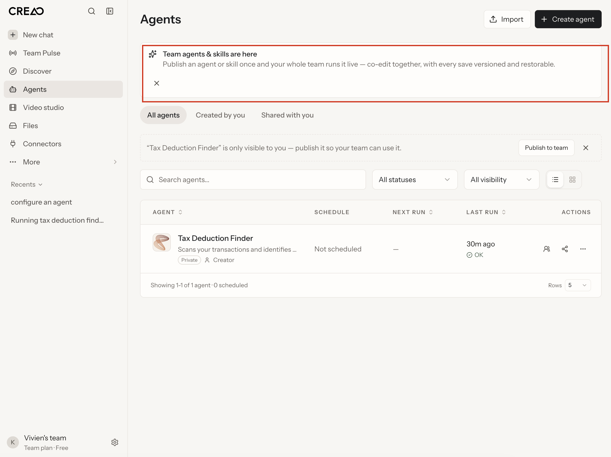

# Creao worked compliance audit

2026-10-11 · Baseline: [design-system-guideline.md](design-system-guideline.md) v1.0. Product-layer design review, not legal or accessibility certification.

## Evidence and status

Six Figma specimens: chat/settings/agent configuration, Light/Dark, [review frame](https://www.figma.com/design/BPE75UDUT8mAXX3NkDmMzE?node-id=2-329). Measurements: `design/generated/screen-review-evidence.json`. Supplied original chat and Agents screenshots establish visible anatomy only. No application runtime exists in this repo.

Fail = visible/measured rule violation. Gap = absent capability/evidence prevents approval. Not assessed = no runtime evidence. Prevention below explains what the specified gate would catch; it does not claim the gate historically ran before the source site shipped.

## Worked findings

| ID / status | Specific violation/evidence | Rule | Exact remediation | How enforcement prevents shipment |
| --- | --- | --- | --- | --- |
| F01 Fail | Settings `2:302` and configuration `2:313` display Continue without wizard context | G05, G07, G08 | Override to Save changes/Save agent, or show actual steps/final save | B02 checks label against outcome; unexplained Continue fails |
| F02 Gap | Generic Field `2:282` represents appearance/language, instructions, models and permissions as static cards | G02, G07, G08 | Authorize typed controls separately; preserve Field | B01 inventory exposes absent APIs; B04 cannot demonstrate selection/editing/permission behavior |
| F03 Gap | Composer follows response in content flow; persistent composer/scroll behavior unproven | G06 | Separate scroll region and persistent composer | B03 long-conversation scroll test demands last-message visibility; absent evidence blocks approval |
| F04 Gap | Seven shared components expose no state properties; default specimens only | G11 | Add authorized state APIs/examples and test interactions | B04 requires state matrix; missing focus/disabled/loading/error/streaming blocks approval |
| F05 Fail | Leading active indicator inconsistent in current renders, visible for Dark Agents but absent in several other selections | G03 | Correct existing instance visibility overrides in six screens | B02 compares each active route to raised surface + Medium label + indicator rule |
| F06 Fail | Main frames `2:344`, `2:367`, `2:390` have 14px horizontal padding | G04 | Use 16px horizontal spacing-unit inset consistently | B02 geometry check detects non-multiple; A rejects literal CSS padding if implemented in scanned app files, not Figma |
| F07 Fail | Chat heading at main edge, settings/config headings inset an extra nested 24px | G04 | Align screen heading slots; preserve panel definition | B02 measures heading position relative to main bounds |
| F08 Gap | Navigation Regular 14/20 and Recents 12/20 have unmanaged style IDs/mapping | G02, G04 | Document mappings or authorize dedicated roles; preserve Medium Label | B01 override inventory/B02 style inspection require approved role mapping |
| F09 Fail/Gap | Navigation one stack mixes utilities/destinations; account follows content | G03 | Named groups and bottom account slot, long-recents review | B02 inspects grouping; B03 verifies footer at changing viewport/content sizes |
| F10 Fail/Gap | Configuration flat list lacks identity/runtime grouping, draft status, scoped permission explanation | G08 | Separate groups; add approved status and permission capability | B02 grouping check plus B04 save/error/permission evidence |
| N01 Fail | Supplied Agents announcement X appears below message near left instead of top-right | G10 | Top-aligned content/dismiss layout; reserve hit area/gap | B03 default and wrapped-content close bounds fail placement test |
| A01 Not assessed | No actual required cue/background contrast measurements provided; faint token alone proves no failure | G12 | Measure both themes/states; choose existing roles or propose extension | B05 missing pair/ratio blocks approval; measured <3:1 fails unless valid exception |
| A02 Not assessed | No new-context link inventory/accessibility evidence | G13 | Warning, accessible name and correct target/rel where intentional | B06 attributes/name/keyboard check catches missing warning under project policy |

## Passing evidence and limits

Sidebar/main surfaces visibly separate in both themes. Original assets are retained. Content Body16/24, Label14/20 and Heading24/32 styles are consistent. Core gaps16, padding24, navigation gaps12 and button padding12/16 follow spacing unit. No default desktop clipping appears. Sole primary appearance is consistent; no available secondary/destructive variant was incorrectly selected.

Foundation gate A passes source/adapters/assets and four extraction tests. It cannot resolve the screen findings. Runtime keyboard, reflow, persistence, contrast and link behavior remain unassessed.

## Missing capability proposals — separate and unapplied

| Extension | Existing definition preserved | Capability proposed | Acceptance gate |
| --- | --- | --- | --- |
| Typed controls | Field2:282 | Input/textarea/select/permission control with label/helper/error | B04 states and B05 contrast |
| Button states/roles | Primary2:280 | State/label/icon slots; secondary/destructive only when needed | B02 hierarchy, B04 states, B05 cues |
| Chat runtime | Composer2:297, Message2:293 | Scroll region, persistent editor, Stop/Retry/attachments | B03 scroll/reflow, B04 recovery |
| Navigation/type roles | Navigation2:285 and current styles | Explicit groups, selected item and approved Regular/small roles | B01 mappings, B02/B03 consistency |
| Save/status/access | Settings2:302, Configuration2:313 | Dirty/save outcomes, scoped permission controls, separate optional Test | B02 groups, B04 persistence |
| Notification | Source x and existing tokens | Content/action/dismiss slots with top-right close | B03 positioning, B04 focus, B05 contrast |
| External link | Source assets/styles | Current-context default; explicit warning/name for new context | B06 links |

Top-right dismissal placement is explicitly approved. Other shared capability changes await explicit authorization. No extension proposes a replacement token family.

## Decision and retest

**Blocked as complete implementation specifications:** visible violations and capability gaps remain. Live Creao was not modified. For every fix record finding ID, commit, component/screen IDs, theme/viewport/state, applicable B check, before/after evidence and reviewer. Close Fail only after the check passes; close Gap only after authorized capability and evidence exist. Documentation edits alone cannot close runtime findings.
