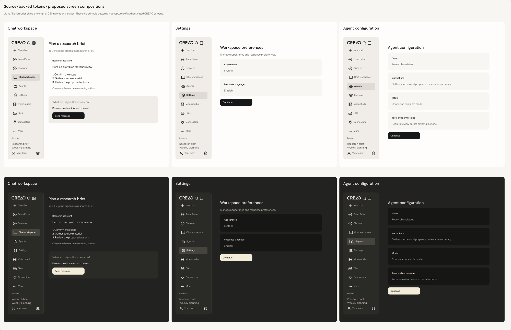

# Creao Design System Guideline

Original icon and logo usage is specified in [the asset system](design/icon-system.md). Use those editable components with existing variables; SVG artwork is not stored as a replacement variable system.

Version: 0.2 · Updated: 2026-10-11 · Status: source-backed project baseline

## Scope and evidence

This guideline defines the starting visual and interaction rules for the vivienk/Creao project. It is based on inspection of CREAO's publicly served stylesheet, not an official CREAO design-system publication. The filename preserves the requested spelling.

- Reference app: https://agent.creao.ai/chat
- Inspected CSS: https://agent.creao.ai/assets/index-C3VRtTd6.css
- CSS identifies Tailwind CSS 4.2.1. The component library remains unverified; do not assume shadcn/ui or Radix.
- Authenticated chat screens were not inspected. CSS declarations establish available tokens, not their actual use on every screen.
- Values marked observed come from the stylesheet. Rules marked proposed are project implementation choices.

The pinned CSS is the project token authority. See [source ownership and cascade](design/source-of-truth.md), [exact Figma mapping](design/figma-mapping.md), [reusable screen patterns](design/screen-patterns.md), and [code/review enforcement](design/enforcement.md). There are 274 theme variables and four Dark-only declarations; no replacement palette or spacing-token family is introduced.

## Visual direction

Current specimens are shown for visual context. Follow [the screen review](design/screen-review.md) for known gaps; this image does not claim those findings have been fixed.

Use warm neutral surfaces, charcoal text, restrained accents, clear hierarchy, and generous spacing. Preserve readability across both themes. Use color for meaning and emphasis rather than decorative saturation. This direction is an interpretation of the observed tokens.

## Color tokens — observed

Map application styles to semantic roles rather than repeating hex values.

| CSS token | Light | Dark | Intended role |
| --- | --- | --- | --- |
| `--color-background` | `#F8F6F3` | `#161615` | Page canvas |
| `--color-foreground` | `#16181A` | `#ECE2DD` | Main text |
| `--color-surface` | `#FEFDFB` | `#222220` | Base panels |
| `--color-surface-alt` | `#F0EDE8` | `#2A2A27` | Alternate panels |
| `--color-surface-elevated` | `#EBE7E2` | `#353530` | Elevated surfaces |
| `--color-surface-raised` | `#DFDAD3` | `#45453E` | Raised surfaces |
| `--color-primary` | `#16181A` | `#F3ECD8` | Primary emphasis |
| `--color-primary-foreground` | `#F3ECD8` | `#1B1B19` | Text on primary |
| `--color-muted` | `#6E6863` | `#A8A097` | Secondary text |
| `--color-border` | `#E6E2DB` | `#F3ECD81A` | Decorative dividers |
| `--color-ring` | `#16181A` | `#C9C2B3` | Focus indication |
| `--color-success` | `#4A6552` | `#7A9684` | Success |
| `--color-error` | `#6E2F2C` | `#CF8772` | Error |
| `--color-oxblood` | `#6E2F2C` | `#CF8772` | Oxblood accent |

Eight-digit hex values include alpha. Test them after compositing onto the actual surface. Border tokens are not automatically suitable as the sole visible boundary of a control.

## Typography — observed families, proposed usage

| Role | Observed family / fallback | Proposed usage |
| --- | --- | --- |
| UI / body | Instrument Sans Variable → Inter Variable → system sans | Navigation, forms, messages |
| Display | DM Sans Variable → Instrument Sans Variable → Inter Variable | Page titles and prominent headings |
| Data | DM Mono → JetBrains Mono Variable → system mono | Code, identifiers, aligned numeric data |
| Serif | EB Garamond Variable → Georgia | Optional editorial content; avoid routine controls |

Use existing `--text-*`, matching `--text-*--line-height`, `--font-*` and `--font-weight-*` values. Figma Body 16/24, Label 14/20 and Heading 24/32 styles compose existing values; these role combinations are proposed usage, not observed screen measurements. CSS remains in its original units. Allow zoom and wrapping and avoid fixed-height text containers.

## Spacing and shape

Observed spacing unit: `--spacing: .25rem` (4px at a 16px root). Observed base radius: `--radius: .375rem` (6px at a 16px root).

Use multiples of the existing `--spacing` unit: `calc(var(--spacing) * n)`. Do not create a parallel named spacing scale. Reuse source `--radius`, `--radius-xs` through `--radius-3xl` rather than minting replacement corner tokens. Pattern geometry and multiplier choices are documented separately from source declarations.

## Component rules — proposed

Approved notification placement: dismiss controls remain at the notification container's top-right, with reserved content space and predictable keyboard focus. See [notification contract and observed defect](design/notification-pattern.md). This applies to dismissible banners, popups and toasts.

| Component | Rules and required states |
| --- | --- |
| Button | One primary action per action group; secondary and destructive variants; default, hover, active, focus, disabled, loading. Keep a stable label during loading. |
| Input / textarea | Persistent visible label; helper and error text associated with the field; default, focus, invalid, disabled. Placeholder is an example, not the label. |
| Card / panel | Semantic surface and padding tokens; concise title; avoid making a whole card clickable when it contains other controls. |
| Navigation | Persistent active state and accessible label; logical keyboard order; mobile disclosure with focus restoration. |
| Dialog | Accessible title, initial focus, focus containment, close control, Escape where appropriate, and focus returned to the opener. |
| Menu / tabs | Correct semantics and keyboard behavior; selected state communicated beyond color. |
| Toast / status | Concise message and appropriate announcement; errors also remain available beside the affected control. |
| Chat composer | Labeled editor and send control; documented Enter/Shift+Enter behavior; composing text remains intact after recoverable failure. |
| Agent response | Distinguish pending, streaming, complete, stopped, and failed; announce meaningful updates without reading every streamed token. |

Keep icons consistent in stroke, alignment, and optical size. Icon-only controls need accessible names. Do not infer a specific icon package from appearance alone.

## Responsive behavior — proposed

Use content-driven breakpoints and document the decisions; no breakpoint-token authority is asserted. Collapse secondary navigation on narrow screens, allow the composer and messages to fill the available width, and confine horizontal scrolling to code blocks or genuinely two-dimensional content. Check narrow widths, text enlargement, and keyboard-open mobile layouts.

## Accessibility and motion

Apply the [high-priority accessibility requirements](design/accessibility-priority-issues.md): required non-text control/state cues must meet 3:1 against adjacent colors; intentional new-context links must provide visible and accessible advance warning under project policy. Preserve source definitions and propose any missing capability separately.

Target WCAG 2.2 AA. Test keyboard access, focus visibility, accessible naming, error handling, zoom, reflow, and screen-reader behavior using the [W3C reference](https://www.w3.org/WAI/WCAG22/quickref/). Automated checks alone do not establish conformance.

Project rules: preserve visible focus, provide text alongside status colors, prefer 44px touch targets, and honor reduced motion. Reuse the observed `--default-transition-duration: .15s` and existing easing expressions where appropriate; these declarations do not establish every component's animation. Avoid animation that delays a user action or moves focused controls.

## Implementation and change control

1. Import the generated adapter from the pinned CSS; preserve original names and aliases.
2. Build shared components before composing screens; specify all interaction states.
3. Test both themes and responsive layouts at the component and screen level.
4. Record deviations with rationale, owner, and review date in the audit.
5. Update this guideline when approved tokens or patterns change.

Before release, attach screenshots and test evidence to [compliance-audit.md](compliance-audit.md). No implementation has been certified by this guideline.
